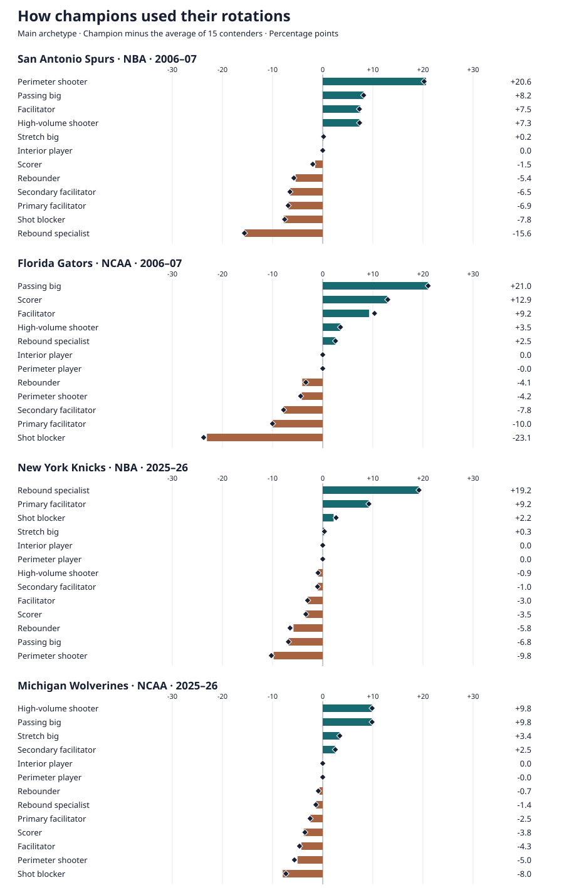
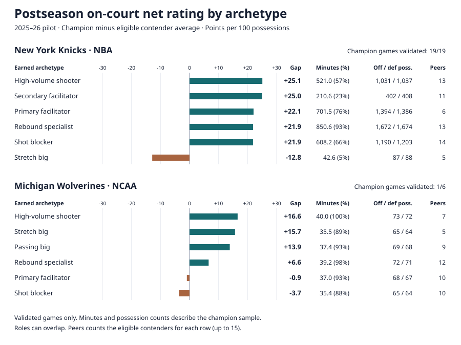

# Basketball Archetype Project

Which player roles show up in championship rotations, and how do they differ between the NBA and NCAA Division I men’s basketball? The pilot covers 2006–07 and 2025–26. It uses stats from before the postseason to compare NBA champions with the other playoff teams and NCAA champions with the other Sweet 16 teams.

## Pilot rotation comparison

Bars show the difference in rotation share in percentage points. The diamond shows the result after grouping low-confidence assignments as uncertain. The pilot uses provisional position benchmarks and covers four champions.

- [Full role comparison, including the final eight](pilot_role_comparison.csv)
- [Stretch-big comparison at both shooting-volume cutoffs](pilot_stretch_big_comparison.csv)
- [Shared archetype rubric](Archetype%20Rubric.md)
- [Data sources and reproduction steps](Pilot%20Data.md)

## Full historical study

The historical files cover 20 NBA playoff fields and 19 NCAA Sweet 16 fields from 2006–07 through 2025–26. The 2020 NCAA tournament was canceled.

- [Team-by-team rotation shares](historical_team_rotations.csv)
- [Champions compared with the full field and final eight](historical_role_comparison.csv)
- [Player archetypes, confidence ratings, and earned roles](historical_archetypes.csv)
- [Postseason teams and outcomes](historical_postseason_teams.csv)
- [Historical data sources and reproduction steps](Historical%20Data.md)

## On-court plus-minus pilot

Bars show the champion's on-court net rating for each role minus the average of eligible contenders, in points per 100 possessions. Minutes count time with at least one player of the role on the floor. Each team needs at least 30 offensive and 30 defensive possessions for a role to enter the comparison.

- **NBA:** All 85 playoff games passed the team scoring and clock checks, including all 19 Knicks games.
- **NCAA:** 25 of 67 tournament games passed, including 20 games involving a Sweet 16 team. Michigan's panel covers its second-round game against Saint Louis. The college panel is a partial sample.

[Team role results](on_court_team_roles.csv) · [Champion comparisons](on_court_role_comparison.csv) · [Team coverage](on_court_team_coverage.csv) · [Game audit](on_court_reconstruction_audit.csv) · [Method](On%20Court%20Pilot.md)
